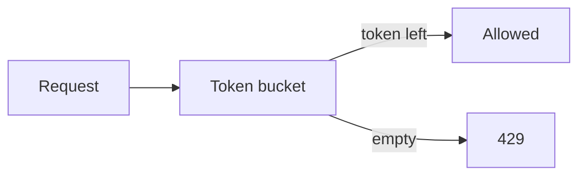

A rate limiter does not slow things down a little. On every request it decides whether the call gets in or gets rejected.

## The problem

Without a limit, one noisy client eats capacity that belongs to everyone else. The check has to be cheap, and it has to stay honest when retries show up.

## The token

The bucket holds tokens. Each request spends one. Time refills tokens up to a cap. If none are left, the answer is 429 and the work does not enter.



A leaky bucket is the other classic drawing: output is constant, and the excess is queued or dropped. A token bucket allows a short burst the size of the bucket, then settles back to the refill rate. For a public API I usually prefer a token bucket, because a legitimate client sometimes arrives all at once and I do not want to punish that.

## The skeleton

The count lives per key. The key can be the user, the IP, or the route. Refill and spend have to happen together: if another thread reads the tokens in between, the limit lies.

```java
boolean allow(String key) {
    Bucket bucket = buckets.computeIfAbsent(key, Bucket::full);
    bucket.refill(clock.now());
    if (bucket.tokens < 1) {
        return false;
    }
    bucket.tokens -= 1;
    return true;
}
```

What this note does not settle yet: where the bucket lives when there is more than one instance. Memory only works for a single process. With several, the count has to live outside, or the limit is multiplied by the number of nodes.
