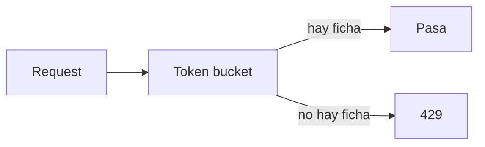

Un rate limiter no frena un poco. En cada request decide si entra o si se rechaza.

## Qué problema resuelve

Sin límite, un cliente ruidoso se come la capacidad de los demás. El límite tiene que ser barato de evaluar y estable cuando llegan reintentos.

## La ficha

El bucket guarda fichas. Cada request gasta una. El tiempo rellena fichas hasta un máximo. Si no queda ninguna, la respuesta es 429 y el trabajo no entra.



Leaky bucket es el otro dibujo clásico: la salida es constante y el exceso se encola o se tira. Token bucket permite un ráfaga corta, del tamaño del bucket, y luego vuelve al ritmo de relleno. Para una API pública suelo preferir token bucket porque un cliente legítimo a veces llega de golpe y no quiero castigarlo por eso.

## El esqueleto

La cuenta vive por clave. La clave puede ser el usuario, la IP o la ruta. Refill y gasto tienen que ocurrir juntos: si otro hilo lee las fichas en medio, el límite miente.

```java
boolean allow(String key) {
    Bucket bucket = buckets.computeIfAbsent(key, Bucket::full);
    bucket.refill(clock.now());
    if (bucket.tokens < 1) {
        return false;
    }
    bucket.tokens -= 1;
    return true;
}
```

Lo que todavía no cierra este apunte: dónde vive el bucket si hay más de una instancia. En memoria solo vale para un proceso. Con varias, la cuenta tiene que estar fuera, o el límite se multiplica por el número de nodos.
